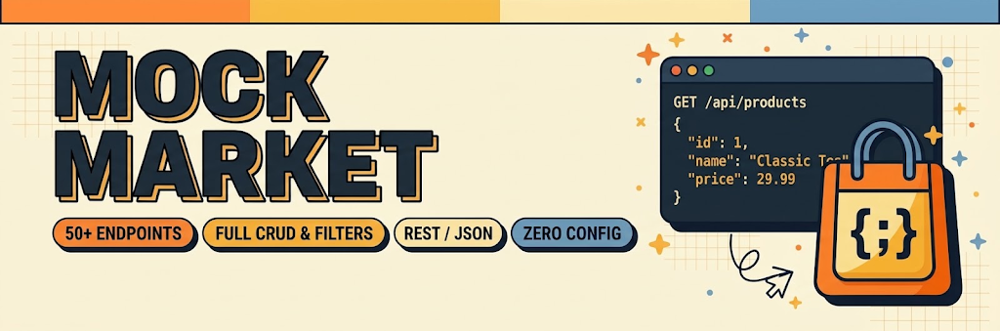

<p align="center">
  
</p>

<p align="center">
  <a href="https://privatestack-townhall.github.io/mock-market/">
    
  </a>
  <a href="#-daftar-koleksi-dataset-50-endpoints">
    
  </a>
  <a href="#-daftar-koleksi-dataset-50-endpoints">
    
  </a>
  <a href="LICENSE">
    
  </a>
</p>

---

# 🛒 Mock Market — Json Raw Data API Server

**Mock Market** adalah server mock RESTful API modular berbasis **Express.js** dan **json-server** yang menyediakan **50+ endpoint/koleksi dataset** dengan total **1250+ data record** realistis siap pakai.

Didesain khusus untuk kebutuhan prototyping cepat, pengujian frontend (*React, Next.js, Vue, Svelte, Angular*), aplikasi mobile (*Flutter, React Native, Swift, Kotlin*), hingga showcase portofolio tanpa repot menyiapkan database nyata.

Dapat digunakan secara langsung melalui **GitHub Pages** (mode statis tanpa instalasi) maupun dijalankan secara lokal dengan backend **Express.js** (mendukung full REST CRUD, Hot Reload, & json-server routing).

---

## 🌐 Akses Live di GitHub Pages

Akses dashboard katalog interaktif dan dataset JSON langsung dari browser tanpa perlu install dependensi:

- 🖥️ **Web Catalog Dashboard**: [https://privatestack-townhall.github.io/mock-market/](https://privatestack-townhall.github.io/mock-market/)
- 📦 **Direct Static JSON Access**:
  ```http
  https://privatestack-townhall.github.io/mock-market/data/<collection>.json
  ```
  **Contoh:**
  - `products.json`: [https://privatestack-townhall.github.io/mock-market/data/products.json](https://privatestack-townhall.github.io/mock-market/data/products.json)
  - `users.json`: [https://privatestack-townhall.github.io/mock-market/data/users.json](https://privatestack-townhall.github.io/mock-market/data/users.json)
  - `articles.json`: [https://privatestack-townhall.github.io/mock-market/data/articles.json](https://privatestack-townhall.github.io/mock-market/data/articles.json)

---

## ✨ Fitur Utama

- **50+ Koleksi Dataset Modular**: Meliputi Commerce, Finance, CMS, HR, LMS, Social/Chat, IoT, Travel, Helpdesk, hingga System Logs.
- **1250+ Record Data Realistis**: Setiap dataset berisi 25+ item lengkap dengan field spesifik (ID, UUID, slug, timestamp ISO, harga, status, rating, tags).
- **Dual-Mode Execution**:
  - **Online (GitHub Pages)**: Akses cepat dataset statis dengan simulator query interaktif berbasis client-side.
  - **Local (Express.js + json-server)**: Full REST CRUD (`GET`, `POST`, `PUT`, `PATCH`, `DELETE`).
- **Dashboard Katalog Interaktif**: Antarmuka web neo-brutalisme dengan fitur pencarian instan, filter kategori, copy cURL, JSON inspector, serta tema *Warm Daylight* dan *Dark Slate*.
- **CORS Otomatis**: Siap diakses dari aplikasi mana pun (*localhost*, *Codesandbox*, *Vercel*, emulator mobile).
- **Query Parameter Lengkap**: Mendukung pagination, pengurutan (*sorting*), filter nilai persis, perbandingan angka (*range*), dan pencarian teks bebas (*full-text search*).

---

## 🛠️ Panduan Menjalankan Secara Lokal

### 1. Prasyarat
- [Node.js](https://nodejs.org/) versi 18 atau lebih baru.
- npm atau pnpm / yarn.

### 2. Instalasi Dependensi
```bash
git clone https://github.com/PrivateStack-TownHall/mock-market.git
cd mock-market
npm install
```

### 3. Menjalankan Server
```bash
# Menjalankan server standar
npm start

# Mode development dengan auto-reload (Node.js --watch)
npm run dev
```

Server akan aktif secara default di:
- **Katalog Web**: [http://localhost:1500/](http://localhost:1500/)
- **API Root**: [http://localhost:1500/api](http://localhost:1500/api)
- **JSON Schema Catalog**: [http://localhost:1500/api?format=json](http://localhost:1500/api?format=json)

*(Port dapat disesuaikan menggunakan environment variable `PORT`, contoh: `PORT=3000 npm start`)*

### 4. Verifikasi & Testing
Jalankan integration test otomatis untuk memvalidasi seluruh dataset dan endpoint server:
```bash
npm test
```

---

## 📋 Daftar Koleksi Dataset (50+ Endpoints)

<details open>
<summary><b>1. Commerce, Billing & Fintech</b></summary>

| No | Endpoint | Items | Deskripsi Entitas |
|---|---|:---:|---|
| 1 | `/api/bank_accounts` | 25+ | Rekening bank nasabah dengan nomor akun, saldo, dan status verifikasi |
| 2 | `/api/brands` | 25+ | Profil brand teknologi, lifestyle, agensi, dan F&B |
| 3 | `/api/carts` | 25+ | Keranjang belanja pengguna dengan item array dan subtotal |
| 4 | `/api/categories` | 25+ | Kategori produk dan konten dengan slug & icon |
| 5 | `/api/coupons` | 25+ | Kupon diskon belanja (persentase & potongan tetap) beserta tanggal aktif |
| 6 | `/api/cryptos` | 25+ | Data aset kripto dengan ticker, harga terkini USD, dan market cap |
| 7 | `/api/expenses` | 25+ | Catatan pengeluaran operasional perusahaan dengan kategori & merchant |
| 8 | `/api/flights` | 25+ | Jadwal penerbangan komersial dengan kode IATA, maskapai, dan harga tiket |
| 9 | `/api/hotels` | 25+ | Akomodasi hotel dengan rating bintang, kota, fasilitas, dan harga per malam |
| 10 | `/api/invoices` | 25+ | Tagihan invoice klien lengkap dengan jatuh tempo, pajak, dan status pembayaran |
| 11 | `/api/leads` | 25+ | Prospek pipeline penjualan B2B dengan estimasi budget dan status deal |
| 12 | `/api/orders` | 25+ | Transaksi checkout pesanan pelanggan beserta rincian pengiriman |
| 13 | `/api/products` | 25+ | Katalog produk gadget, workstation, aksesoris dengan harga, stok, & gambar |
| 14 | `/api/transactions` | 25+ | Riwayat transaksi pemasukan dan pengeluaran finansial |

</details>

<details>
<summary><b>2. Users, Healthcare & HR</b></summary>

| No | Endpoint | Items | Deskripsi Entitas |
|---|---|:---:|---|
| 15 | `/api/appointments` | 25+ | Reservasi janji temu pasien dan dokter spesialis dengan jadwal |
| 16 | `/api/chats` | 25+ | Riwayat pesan obrolan langsung (direct message) antar pengguna |
| 17 | `/api/doctors` | 25+ | Data profil dokter spesialis dengan rumah sakit dan biaya konsultasi |
| 18 | `/api/employees` | 25+ | Data karyawan internal lengkap dengan departemen, posisi, dan tanggal masuk |
| 19 | `/api/feedbacks` | 25+ | Masukan dan rating kepuasan pelanggan terhadap layanan |
| 20 | `/api/instructors` | 25+ | Profil mentor & instruktur pelatihan coding dengan rating |
| 21 | `/api/students` | 25+ | Data siswa bootcamp dengan kursus yang diambil dan IPK/GPA |
| 22 | `/api/subscriptions` | 25+ | Paket langganan SaaS pengguna (Free, Starter, Pro, Enterprise) |
| 23 | `/api/todos` | 25+ | Daftar tugas teknis tim engineering dengan prioritas & tenggat waktu |
| 24 | `/api/users` | 25+ | Profil pengguna (admin, developer, designer, customer) beserta alamat |
| 25 | `/api/workouts` | 25+ | Log latihan kebugaran harian dengan target otot dan estimasi kalori |

</details>

<details>
<summary><b>3. Content, Media & Education</b></summary>

| No | Endpoint | Items | Deskripsi Entitas |
|---|---|:---:|---|
| 26 | `/api/articles` | 25+ | Artikel blog & tutorial tech lengkap dengan HTML content & SEO metadata |
| 27 | `/api/badges` | 25+ | Lencana pencapaian gamifikasi dengan rarity tier dan reward points |
| 28 | `/api/comments` | 25+ | Komentar pengguna pada artikel/postingan beserta likes count |
| 29 | `/api/courses` | 25+ | Kursus pelatihan coding intensif dengan silabus dan durasi jam |
| 30 | `/api/faqs` | 25+ | Tanya jawab bantuan umum, teknis, dan troubleshooting |
| 31 | `/api/media` | 25+ | Galeri aset media visual dengan URL resolusi tinggi |
| 32 | `/api/movies` | 25+ | Data film sinema dengan sutradara, genre, tahun rilis, dan skor IMDb |
| 33 | `/api/pharmacy_items` | 25+ | Katalog obat-obatan farmasi dengan produsen, dosis, dan harga |
| 34 | `/api/playlists` | 25+ | Daftar putar musik dengan genre, kreator, dan jumlah pengikut |
| 35 | `/api/podcasts` | 25+ | Episode siniar audio dengan nama host, topik, dan durasi |
| 36 | `/api/quotes` | 25+ | Kutipan inspiratif & prinsip clean code dari tokoh industri teknologi |
| 37 | `/api/recipes` | 25+ | Resep masakan nusantara & internasional dengan nutrisi & instruksi langkah |
| 38 | `/api/reviews` | 25+ | Review produk dengan rating bintang dan ulasan pelanggan terverifikasi |
| 39 | `/api/surveys` | 25+ | Kuesioner riset publik dengan pertanyaan dan total responden |
| 40 | `/api/tags` | 25+ | Label teknologi (React, Node.js, Kubernetes, AI, dll.) dengan kode warna |
| 41 | `/api/testimonials` | 25+ | Testimoni kepuasan alumni pelatihan dan klien perusahaan |

</details>

<details>
<summary><b>4. System, Workspace & Operations</b></summary>

| No | Endpoint | Items | Deskripsi Entitas |
|---|---|:---:|---|
| 42 | `/api/api_keys` | 25+ | Kunci akses API pengembang dengan scope izin dan rate limit |
| 43 | `/api/audit_logs` | 25+ | Log audit keamanan aktivitas sistem & IP pengguna |
| 44 | `/api/devices` | 25+ | Inventaris perangkat jaringan & server dengan status koneksi |
| 45 | `/api/events` | 25+ | Agenda konferensi, seminar, dan webinar teknologi mendatang |
| 46 | `/api/jobs` | 25+ | Lowongan kerja software engineering dengan rentang gaji dan lokasi |
| 47 | `/api/locations` | 25+ | Titik koordinat destinasi wisata nusantara (latitude, longitude, rating) |
| 48 | `/api/notifications` | 25+ | Notifikasi aktivitas akun, sistem, dan status pesanan |
| 49 | `/api/projects` | 25+ | Showcase portofolio studi kasus aplikasi web & mobile agensi |
| 50 | `/api/restaurants` | 25+ | Daftar restoran kuliner dengan jenis masakan dan rating |
| 51 | `/api/server_metrics` | 25+ | Metrik telemetri performa server (CPU, RAM, region, uptime) |
| 52 | `/api/shipments` | 25+ | Pelacakan status pengiriman logistik dengan nomor resi dan kurir |
| 53 | `/api/tickets` | 25+ | Tiket helpdesk dukungan pelanggan dengan status dan prioritas |
| 54 | `/api/vehicles` | 25+ | Armada rental kendaraan dengan tarif sewa harian |
| 55 | `/api/webhooks` | 25+ | Konfigurasi endpoint webhook sistem dengan persentase keberhasilan |

</details>

---

## 🔍 Panduan Query Parameter REST API

Server mendukung parameter query fleksibel standar json-server:

### 1. Pagination (Membatasi Data per Halaman)
Gunakan `_page` dan `_limit`:
```http
GET /api/products?_page=1&_limit=10
```

### 2. Sorting (Pengurutan Data)
Gunakan `_sort` dan `_order` (`asc` atau `desc`):
```http
GET /api/products?_sort=price&_order=desc
GET /api/articles?_sort=publishedAt&_order=asc
```

### 3. Filtering (Penyaringan Nilai Persis)
Gunakan nama field dan nilai yang dicari:
```http
GET /api/users?role=developer
GET /api/todos?completed=false
GET /api/jobs?type=Full-time
```

### 4. Operator Range (Batas Nilai Angka)
Gunakan `_gte` (>=), `_lte` (<=), `_ne` (!=):
```http
GET /api/products?price_gte=100&price_lte=500
GET /api/doctors?consultationFee_lte=150
```

### 5. Full-Text Search (Pencarian Teks Bebas)
Gunakan `q=` untuk mencari di seluruh kolom:
```http
GET /api/articles?q=react
GET /api/movies?q=nolan
```

### 6. Relasi Antar Entitas (Relationship Filter)
```http
GET /api/orders?userId=1
GET /api/comments?postId=3
```

---

## 📁 Struktur Direktori

```
mock-market/
├── .github/
│   └── workflows/
│       └── static.yml            # CI/CD deployment otomatis ke GitHub Pages
├── data/                         # 50+ Dataset JSON individual (1250+ record)
│   ├── api_keys.json
│   ├── articles.json
│   ├── products.json
│   ├── users.json
│   └── ... (50+ files)
├── scripts/
│   └── generate_datasets.js      # Generator data modular
├── src/                          # Frontend Web Catalog
│   ├── banner.png                # Banner resmi Mock Market
│   ├── index.html                # Tampilan katalog web interaktif
│   ├── script.js                 # Logika interaktif & dual-mode engine
│   ├── style.css                 # Custom stylesheet & theme palette
│   ├── logo.jpg                  # Logo Mock Market
│   └── favicon.*                 # Asset ikon web multi-resolusi
├── test/
│   └── verify.js                 # Automated verification test suite
├── .gitignore
├── package.json
├── server.js                     # Server utama Express.js + json-server router
└── README.md
```

---

## 📄 Lisensi

Didistribusikan di bawah lisensi **ISC**. Bebas digunakan untuk keperluan personal, edukasi, maupun komersial.

Dibuat dengan ❤️ oleh **Vincent Sadino G**.
